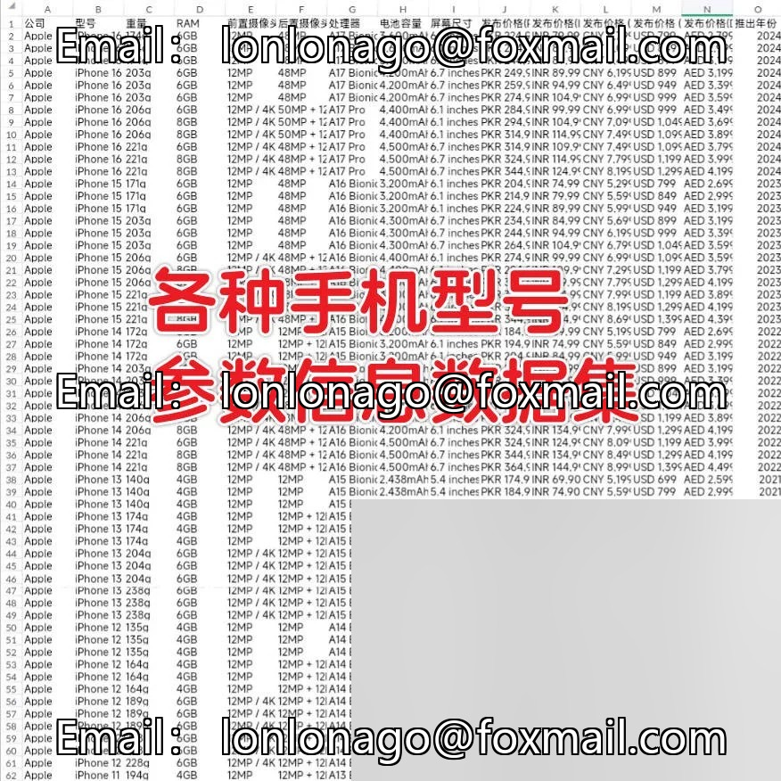
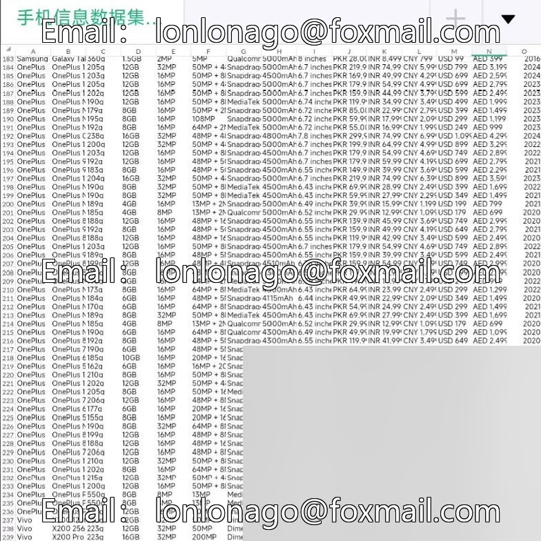
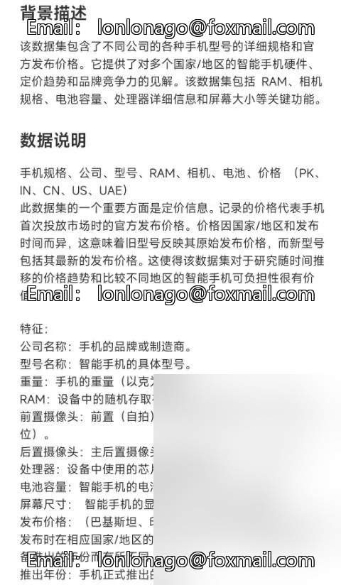

# 2025 various smartphone model parameter information dataset

## Body

2025 various phone model parameter information dataset
Including key functions such as RAM, camera specifications, battery capacity, detailed processor information, and screen size.
The dataset contains detailed specifications and official release prices for various phone models from different companies. It provides insights into the hardware, pricing trends, and brand competitiveness of smartphones in multiple countries/regions.

Data description
Company name: The brand or manufacturer of the phone.
Model name: The specific model of the smartphone.
Weight: The weight of the phone (in grams).
RAM: The amount of random access memory (RAM) in the device (GB).
Front camera: The resolution of the front (selfie) camera (in MP).
Back camera: The resolution of the main rear camera (in MP).
Processor: The chip set or processor used in the device.
Battery capacity: The battery capacity of the smartphone (in mAh).
Screen size: The display size of the smartphone (in inches).

Release prices: (Pakistan, India, China, USA, Dubai): official release prices of mobile devices when released in corresponding countries/regions.
Price varies according to the year of the mobile device release.

web-based shipment, can be directly photographed and shipped.

The dataset covers various 2025 mobile phones with key specs such as RAM, camera capacities, battery capacity, processor details, screen size, official release prices, company names, model names and weight.

<!-- AI_ENRICHED -->

## Images

## Payment

Here is a pay link on Stripe ( https://buy.stripe.com/3cs8yP7sY87d0vu9AB ). Please contact me lonlonago@foxmail.com after funding $89, and I will send you a complete data files , thank you!

